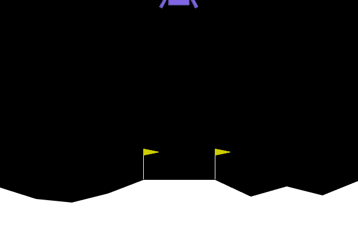
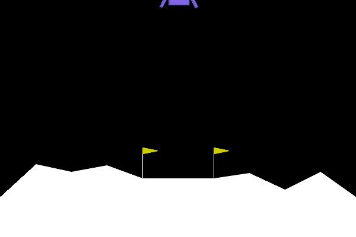
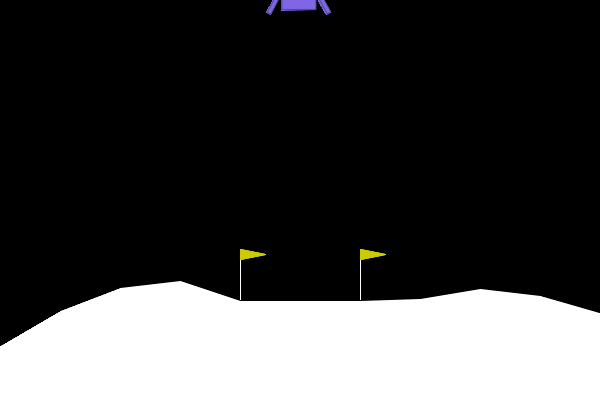

# LunarLander-v3: PPO & Reward Shaping Experiments
This repository contains a set of experiments training a Proximal Policy Optimization (PPO) agent on the LunarLander-v3 environment using Gymnasium and Stable-Baselines3.
The main goal of this project is to demonstrate how naive reward engineering leads to **Reward Hacking** (specification gaming), and how to properly resolve it using **Potential-Based Reward Shaping**.
## Overview & Results
All models were evaluated over 10–20 episodes on the standard, unwrapped LunarLander-v3 environment to measure true performance (where a score of >= 200 is considered solved).
| Experiment | Training Steps | Unwrapped Score (True) | Wrapped Score | Notes |
| :--- | :--- | :--- | :--- | :--- |
| **1. Baseline PPO** | 500k | ~115.21 | N/A | Lands safely, but struggles with fuel efficiency and precision. |
| **2. Naive Reward (Hacked)** | 500k | 6.29 | 974.02 | Agent exploits the +1 step bonus by hovering indefinitely instead of landing. |
| **3. Potential-Based Shaping** | 1M | **268.91** | N/A | Solved. Uses potential difference ($\Phi(s') - \Phi(s)$) and a small step penalty. |
## Methodology
1. **Baseline (`1_baseline.py`):** Standard PPO policy trained directly on the default environment rewards.
2. **Reward Hacking (`2_reward_hacking.py`):** Added a naive +1.0 per-step reward when the lander is upright and moving slowly in the air. Because landing terminates the episode, the agent learned that hovering forever yields a much higher cumulative return than actually completing the task.
3. **Potential-Based Shaping (`3_shaped_reward.py`):** Fixed the hovering exploit by implementing a potential function based on distance to the pad, tilt angle, and angular velocity. Instead of rewarding static states, the wrapper rewards the *improvement* between consecutive frames (current_shaping - prev_shaping), combined with a -0.05 step penalty to encourage timely landings.
## Visual Demos
### 1. Baseline PPO

### 2. Reward Hacking (Hovering Exploit)
*The agent actively burns fuel to stay airborne and farm the step bonus.*

### 3. Solved with Potential-Based Shaping

## Installation & Usage
1. Clone the repository and create a virtual environment:
```bash
git clone [https://github.com/YOUR_USERNAME/lunar-lander-reward-shaping.git](https://github.com/YOUR_USERNAME/lunar-lander-reward-shaping.git)
cd lunar-lander-reward-shaping


the codes are written by Gemini 4.0 Argon

python -m venv venv
source venv/bin/activate  # On Windows: .\venv\Scripts\activate

install the required dependencies
pip install gymnasium[box2d] stable-baselines3 imageio
